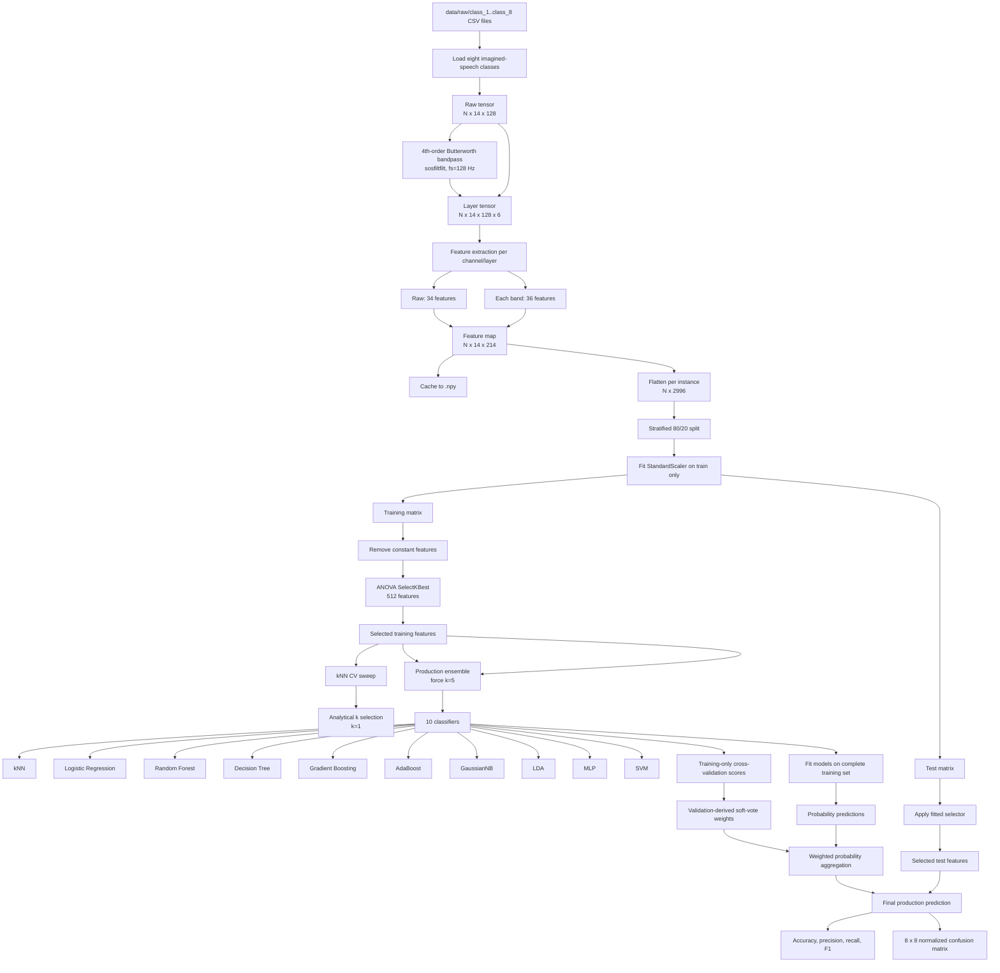
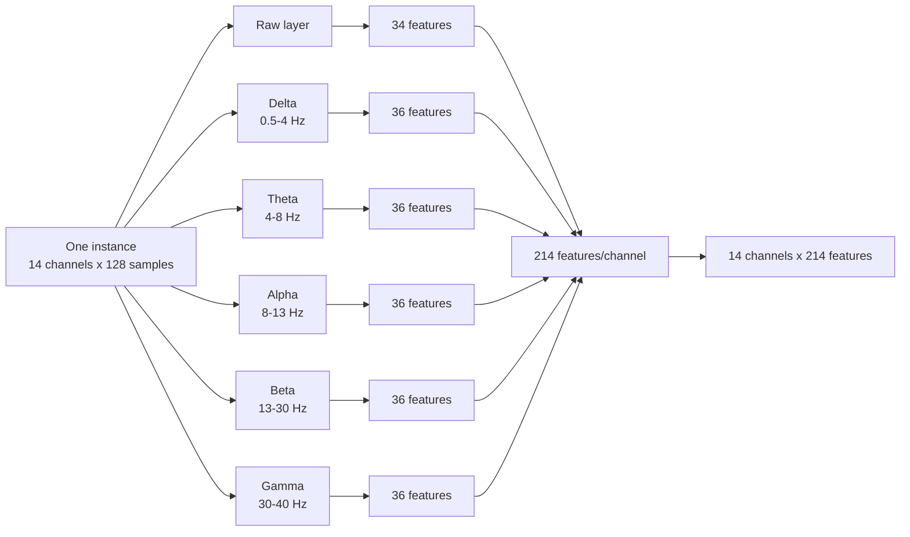
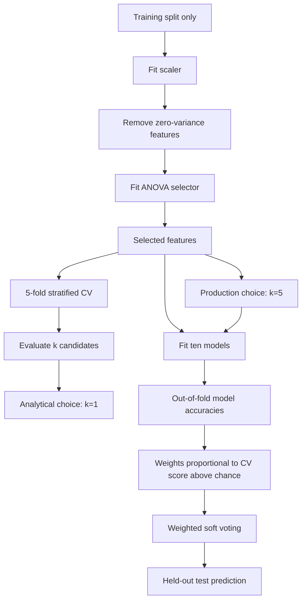

# EEGIS Eight-Class Ensemble Architecture

## End-to-end pipeline

## Feature extraction

Feature groups include statistical descriptors, DFA, Hjorth parameters,
entropy, fractal dimensions, Welch spectral power, spectral edge frequencies,
RQA measures, relative band power, and Hilbert-envelope amplitude. Degenerate
values are converted with `nan_to_num`.

## Model-selection and production boundary

The k=1 result is retained for analysis because it maximized cross-validation
accuracy. Production inference uses k=5 to reduce sensitivity to individual
nearest-neighbor windows and noisy samples.

## Evaluation boundary

The final test set is not used for feature selection, k selection, model
weighting, or hyperparameter tuning. The current headline production result is
the eight-class, random window-level test accuracy with k=5. Subject- or
trial-independent evaluation requires reliable subject/trial identifiers,
which are not present in the supplied dataset release.
